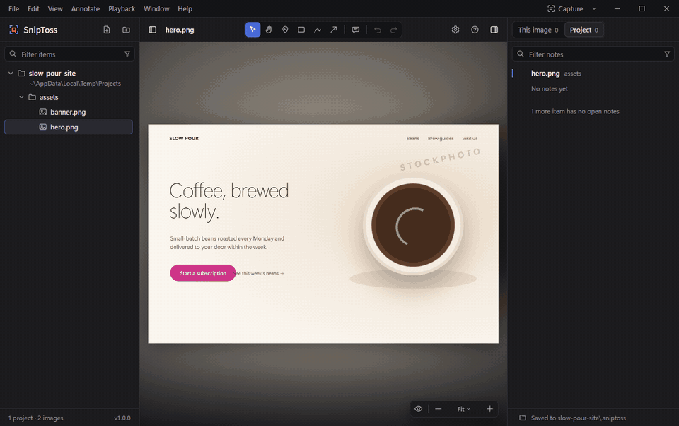

# SnipToss

**English** · [简体中文](README.zh-CN.md)

[](https://github.com/Moy339339/SnipToss/releases/latest) [](https://github.com/Moy339339/SnipToss/actions/workflows/ci.yml) [](LICENSE) 

Annotate the images and videos your coding agent made — then hand the notes straight back to it.

**[Download for Windows 11](https://github.com/Moy339339/SnipToss/releases/latest)** · [Install notes](#install)

SnipToss is a Windows desktop app for reviewing AI-generated assets. Mark what needs to change with a pin, rectangle, pen or arrow, write the change you want, and SnipToss saves the note — its text, position, time and a cropped snapshot — as plain files in the project's `.sniptoss/` folder. Claude Code, Codex and other agents that can read local files pick the notes up from there and fix the assets.

Web pages, mini programs, PDF and slides are planned.



## Features

- **Images and videos**: PNG, JPEG, WebP, GIF, SVG, BMP, AVIF; MP4, WebM, MOV, M4V. Turn on Settings → Advanced → More formats for TIFF, HEIC, ICO, APNG, JFIF and MKV in folders and the context menu (a file opened on its own works either way). HEIC needs the HEIF Image Extension and HEVC Video Extensions from the Microsoft Store. Notes on a video are tied to a moment or a time range, and you can step frame by frame.
- **Notes agents can read**: `.sniptoss/REVIEW.md` lists every open note in plain text (positions in pixels, times as `mm:ss.mmm`), `.sniptoss/annotations/*.json` holds the structured data, `.sniptoss/snapshots/` has one snapshot per note. The format is documented and versioned: [docs/annotation-format.md](docs/annotation-format.md).
- **Two ways to hand off**:
  - **Copy as Text** (`Ctrl+Shift+A`) — for agents that can read local files (Claude Code, Codex): each note's text, plus where the item and the snapshot are in the project.
  - **Copy as Images** (`Ctrl+Shift+I`) — for web-based AI and chat apps: one image per note, with the snapshot and the note underneath.
- **Screen capture with notes** (`Ctrl+Alt+A`, configurable): capture any part of the screen, mark it up, write notes, and copy the result as one image.
- **Library**: add files or folders (drag and drop, `Ctrl+O`, the File Explorer context menu, or paste from the clipboard). Items are grouped by project, and the library notices when an agent re-exports a file after you annotated it.
- **Status is yours**: mark notes Done or Won't Fix (`D` / `Shift+D`), with undo and redo for everything.
- **Keyboard first, mouse friendly**: every command is in the menu bar and has a shortcut; press `?` for the full list.
- **11 languages**: English, 简体中文, 繁體中文, 日本語, 한국어, Français, Deutsch, Español, Italiano, Português (Brasil), Русский. Follows the Windows display language by default.
- **Private**: no telemetry, no account. The only network request is the update check (it asks GitHub for the latest version once a day; you can turn it off in Settings → General). Notes stay on your computer.

## Install

Requirements: 64-bit Windows 11. The release builds include the .NET runtime; the Microsoft Edge WebView2 Runtime comes with Windows 11 (if it's missing, SnipToss shows a download link).

Download from [Releases](https://github.com/Moy339339/SnipToss/releases):

- **Portable** (`SnipToss-<version>-win-x64-portable.zip`): unzip anywhere and run `SnipToss.exe`. Settings, logs and captures are kept in the `data` folder next to it, and nothing is written to the registry — so the context menu and start-at-sign-in options are unavailable. Delete the folder to remove it completely.
- **Installer** (`SnipToss-<version>-win-x64-setup.exe`): installs for your account without administrator rights (or for all users, if you choose so in the first step), adds a Start menu entry and, unless you untick it, "Open with SnipToss" to the File Explorer context menu. To update, run the newer installer; it closes SnipToss if it's running. Uninstall from Settings → Apps → Installed apps.

Or install the portable build with [Scoop](https://scoop.sh) (settings and captures are kept across `scoop update`):

```powershell
scoop bucket add moygoldenage https://github.com/Moy339339/scoop-bucket
scoop install moygoldenage/sniptoss
```

The builds are not code-signed. Windows SmartScreen may say "Windows protected your PC": choose **More info → Run anyway** (it asks again for each new version). Each release lists the SHA256 of its files in `SHA256SUMS.txt`, so you can check a download with `Get-FileHash <file>` in PowerShell.

If **Smart App Control** is on (Windows Security → App & browser control → Smart App Control settings), Windows blocks unsigned apps, SnipToss included, and there is no way to allow a single app. Using SnipToss then means turning Smart App Control off. Since the April 2026 update, Windows 11 can turn it back on later without reinstalling, but SnipToss won't start while it's on.

## Hand notes to your agent

1. Open the asset's folder in SnipToss, annotate, and the notes are saved as you go.
2. Press **Copy as Text** (`Ctrl+Shift+A`) and paste it into Claude Code or Codex. The agent reads `.sniptoss/REVIEW.md` and the snapshots, and changes the files.
3. Check the result in SnipToss — it reloads files that changed — and mark the notes Done.

What gets copied: the notes you checked; if none are checked, every open note listed in the notes panel. Right-click a note, the image, or a row in the library to copy just that.

For agents and scripts the repository also has a command-line tool, `sniptoss` (`packages/cli`, needs Node.js for now): `list`, `review` (regenerate `REVIEW.md`), `resolve <id> -m "…"` and `wontfix <id> -m "…"`. Run `sniptoss --help` for options.

## How it compares

SnipToss reviews the **files** your agent produced — images and videos on disk, or anything on screen via screen capture. It doesn't inspect a running web page.

| | SnipToss | Web page annotators<br>([Agentation](https://github.com/benjitaylor/agentation), [Drawbridge](https://github.com/breschio/drawbridge), [Vibe Annotations](https://github.com/RaphaelRegnier/vibe-annotations)) | Media review for agents<br>([Rushes](https://github.com/iamredmh/rushes), [Telestrator](https://github.com/itsloukman/telestrator)) | Screenshot tools<br>(ShareX, Snagit, CleanShot X) |
|---|---|---|---|---|
| What you annotate | Images and videos on disk; any part of the screen | Elements of a running web page | Videos the agent made (Rushes also images) | Screenshots |
| Notes at a video frame or time range | Yes | No | Yes | No |
| What the agent gets | Files in the project (`.sniptoss/`), copied text, CLI | Copied Markdown, MCP or project files, depending on the tool; with DOM selectors and, in some, source locations | Project files, MCP (Rushes also a CLI) | An image |
| For web-based AI and chat apps | Copy as Images (one image per note) | Copy the text | Not documented | Copy the image |
| Runs as | Windows desktop app, offline | Browser extension, or a package inside your app | Local server, used in the browser (Node.js) | Desktop app |
| MCP server | Not yet | Agentation, Vibe Annotations | Yes | — |
| License | MIT | PolyForm Shield (Agentation, Vibe Annotations); source-available, no redistribution (Drawbridge) | MIT | GPL-3.0 (ShareX); commercial |

- **Building a website?** The web page annotators fit better: they point at the actual element and its source code. SnipToss sees the page only as a screenshot.
- **Reviewing generated video or images?** Rushes and Telestrator also keep notes as files and talk to agents over MCP, in a browser served by a local Node.js process. SnipToss is a native app that opens any image or video on disk without a server, and adds screen capture and Copy as Images for web-based AI.
- **Cloud review** such as [Frame.io](https://frame.io/) needs an account and uploads the media (its MCP server for agents is in public beta). SnipToss keeps everything on your computer.

Compared as of October 2026; these tools change quickly — corrections are welcome.

## Build from source

You need Windows 11, Node.js 24 and the .NET 10 SDK.

```powershell
npm install
pwsh -File scripts/build-app.ps1 -NoBump   # web UI + desktop shell → app/bin/Release/net10.0-windows/SnipToss.exe
npm run verify                             # type check, lint, unit tests (TypeScript and C#), design and i18n checks, UI end-to-end tests
```

`pwsh -File scripts/publish.ps1` makes the self-contained release build and the portable zip in `dist/release`.

See [CONTRIBUTING.md](CONTRIBUTING.md) for the development workflow and [ARCHITECTURE.md](ARCHITECTURE.md) for how the pieces fit together.

## Contributing

Bug reports, translations and pull requests are welcome — see [CONTRIBUTING.md](CONTRIBUTING.md). Translations other than English and Chinese haven't been reviewed by native speakers yet; corrections are especially welcome. Please follow the [Code of Conduct](CODE_OF_CONDUCT.md).

Found a security issue? Please report it privately as described in [SECURITY.md](SECURITY.md).

## Contact

MoyGoldenAge · jujuw3939@outlook.com

## License

[MIT](LICENSE) © 2026 MoyGoldenAge
