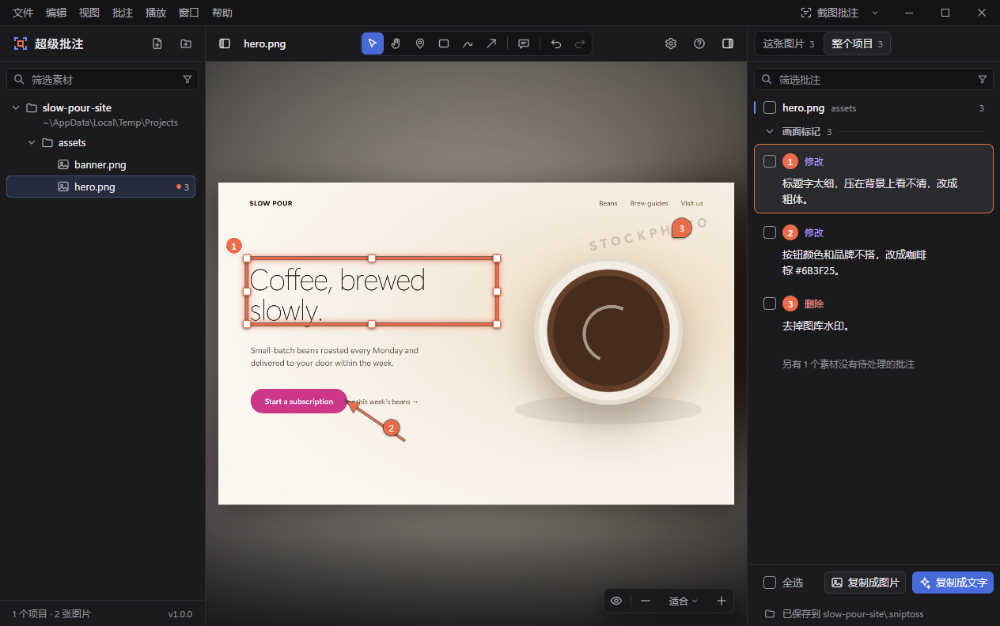

# 超级批注（SnipToss）

[English](README.md) · **简体中文**

[](https://github.com/Moy339339/SnipToss/releases/latest) [](https://github.com/Moy339339/SnipToss/actions/workflows/ci.yml) [](LICENSE) 

给 AI 生成的图片和视频做批注，再把批注原样交回给 AI 修改。

**[下载 Windows 11 版](https://github.com/Moy339339/SnipToss/releases/latest)** · [安装说明](#安装)

超级批注是 Windows 桌面程序，用来审阅 Claude Code、Codex 等生成的素材：用图钉、矩形、画笔或箭头标出要改的位置，写下修改要求，
批注的**内容、位置、时间点**和**标出位置的截图**都以普通文件保存在素材所在项目的 `.sniptoss/` 文件夹中。能读本机文件的 AI agent 直接从那里读取，按意见修改素材。

网页、PDF、PPT 将陆续支持；Mac 版正在开发。



## 功能

- **图片和视频**：PNG、JPEG、WebP、GIF、SVG、BMP、AVIF；MP4、WebM、MOV、M4V。在「设置 → 高级 → 更多格式」中开启后，文件夹和右键菜单还支持 TIFF、HEIC、ICO、APNG、JFIF、MKV（单独打开的文件不受此限）。HEIC 需要 Microsoft Store 里的「HEIF 图像扩展」和「HEVC 视频扩展」。视频批注对应某一时刻或一段时间，可逐帧查看。
- **AI 读得懂的批注**：`.sniptoss/REVIEW.md` 是全部待处理批注的文字汇总（位置换算成像素、时间写成 `mm:ss.mmm`），`.sniptoss/annotations/*.json` 是结构化数据，`.sniptoss/snapshots/` 是每条批注一张截图。格式有文档、有版本号：[docs/annotation-format.zh-CN.md](docs/annotation-format.zh-CN.md)。
- **两种交法**：
  - **复制成文字**（`Ctrl+Shift+A`）：给 Claude Code、Codex 这类能读本机文件的 AI，内容是每条批注的原文，以及素材和截图在项目中的位置。
  - **复制成图片**（`Ctrl+Shift+I`）：给网页版 AI 和聊天软件，一条批注一张图，截图下方附批注内容。
- **截图批注**（`Ctrl+Alt+A`，可在设置中更改）：截取屏幕任意区域，标注、写批注，合成一张图复制出去。
- **素材列表**：拖进窗口、`Ctrl+O`、资源管理器右键菜单、从剪贴板粘贴都能添加文件或文件夹；按项目自动分组；写完批注后 AI 重新导出了素材，会有提示。
- **状态由你标记**：标记为已改或不改（`D` / `Shift+D`），所有操作都能撤销、重做。
- **键盘、鼠标都顺手**：全部操作都在菜单栏里，也都有快捷键，按 `?` 查看。
- **11 种界面语言**：简体中文、繁體中文、English、日本語、한국어、Français、Deutsch、Español、Italiano、Português (Brasil)、Русский，默认跟随 Windows 显示语言。
- **隐私**：不收集数据、不需要账号。唯一的联网是检查更新（每天最多向 GitHub 查询一次版本号，可在设置 → 常规中关闭）。批注只留在你的电脑上。

## 安装

系统要求：64 位 Windows 11。发布版自带 .NET 运行时；Microsoft Edge WebView2 运行时 Windows 11 已内置（缺少时程序会给出下载链接）。

从 [Releases](https://github.com/Moy339339/SnipToss/releases) 下载：

- **绿色版**（`SnipToss-<版本>-win-x64-portable.zip`）：解压到任意位置，运行 `SnipToss.exe`。设置、日志、截图都存在旁边的 `data` 文件夹里，不写注册表，所以右键菜单、登录时启动两项不可用。删掉文件夹即彻底移除。
- **安装版**（`SnipToss-<版本>-win-x64-setup.exe`）：默认只为当前账户安装，不需要管理员权限（第一步也可选择为所有用户安装）；会添加开始菜单项，并默认把「用超级批注打开」加进资源管理器右键菜单（可取消勾选）。升级时运行新版安装包即可，程序开着会先自动关闭。卸载请到「设置 → 应用 → 已安装的应用」。

也可以用 [Scoop](https://scoop.sh) 安装绿色版（`scoop update` 升级时设置和截图都会保留）：

```powershell
scoop bucket add moygoldenage https://github.com/Moy339339/scoop-bucket
scoop install moygoldenage/sniptoss
```

程序未进行代码签名。Windows SmartScreen 可能提示「Windows 已保护你的电脑」，点「更多信息 → 仍要运行」即可（每个新版本会再提示一次）。每个版本都附有 `SHA256SUMS.txt`，可以在 PowerShell 里用 `Get-FileHash <文件>` 核对下载的文件。

如果开着**智能应用控制**（「Windows 安全中心 → 应用和浏览器控制 → 智能应用控制设置」），Windows 会拦下所有未签名的程序，包括超级批注，且无法单独放行某一个程序，只能关掉智能应用控制后再使用。2026 年 4 月的更新之后，Windows 11 关掉它以后还能重新打开、无需重装系统，但它开着时超级批注无法启动。

## 把批注交给 AI

1. 在超级批注里打开素材所在的文件夹，写批注，写完即自动保存。
2. 按「复制成文字」（`Ctrl+Shift+A`），粘贴到 Claude Code 或 Codex 的对话里。粘贴的文字里有每条批注的内容、位置和截图路径，AI 查看截图后修改文件。AI 也可以自己读 `.sniptoss/REVIEW.md`，里面列着全部待处理的批注。
3. 回到超级批注查看结果（文件改动后会自动重新载入），把批注标记为已改。

复制范围：勾选了批注时复制勾选的；没勾选时复制批注栏中列出的全部待处理批注。右键单击某条批注、画面或素材栏中的某一行，只复制那一条 / 那一份 / 那一行。

仓库里还有给 agent 和脚本用的命令行工具 `sniptoss`（`packages/cli`，目前需要 Node.js）：`list`、`review`（重新生成 `REVIEW.md`）、`resolve <id> -m "…"`、`wontfix <id> -m "…"`，选项见 `sniptoss --help`。

## 和同类工具的区别

超级批注审阅的是 AI 做出来的**文件**：磁盘上的图片和视频，或者经截图批注截下的屏幕上任何东西。它不读取运行中的网页。

| | 超级批注 | 网页批注工具<br>（[Agentation](https://github.com/benjitaylor/agentation)、[Drawbridge](https://github.com/breschio/drawbridge)、[Vibe Annotations](https://github.com/RaphaelRegnier/vibe-annotations)） | 给 agent 的素材审阅<br>（[Rushes](https://github.com/iamredmh/rushes)、[Telestrator](https://github.com/itsloukman/telestrator)） | 截图工具<br>（ShareX、Snagit、CleanShot X） |
|---|---|---|---|---|
| 批注什么 | 磁盘上的图片、视频；屏幕任意区域 | 运行中网页上的元素 | AI 做的视频（Rushes 也支持图片） | 截图 |
| 视频批注到某一帧或一段时间 | 支持 | 不支持 | 支持 | 不支持 |
| AI 拿到什么 | 项目里的文件（`.sniptoss/`）、复制的文字、命令行 | 复制的 Markdown、MCP 或项目里的文件（各工具不同），带 DOM 选择器，有的还带源码位置 | 项目里的文件、MCP（Rushes 另有命令行） | 一张图 |
| 给网页版 AI、聊天软件 | 复制成图片（一条批注一张图） | 复制文字 | 文档未提 | 复制图片 |
| 运行方式 | Windows 桌面程序，离线 | 浏览器扩展，或装进你的网页项目的组件 | 本机服务，在浏览器里用（Node.js） | 桌面程序 |
| MCP 服务 | 暂无 | Agentation、Vibe Annotations 有 | 有 | — |
| 许可证 | MIT | PolyForm Shield（Agentation、Vibe Annotations）；源码可见、不许再分发（Drawbridge） | MIT | GPL-3.0（ShareX）；商业软件 |

- **在做网站？** 网页批注工具更合适：它们能指到具体元素和对应的源码。超级批注只能把网页当截图看。
- **审 AI 生成的视频、图片？** Rushes、Telestrator 同样把批注存成文件、经 MCP 交给 AI，界面在浏览器里，由本机的 Node.js 服务提供。超级批注是原生程序，打开磁盘上任意图片、视频，不用起服务；另有截图批注和给网页版 AI 的「复制成图片」。
- **云端审片**（如 [Frame.io](https://frame.io/)）要账号、要把素材传上去（它给 agent 的 MCP 服务在公开测试）。超级批注的一切都留在你的电脑上。

以上对比截至 2026 年 10 月；这些工具变化很快，欢迎指正。

## 从源码构建

需要 Windows 11、Node.js 24 和 .NET 10 SDK。

```powershell
npm install
pwsh -File scripts/build-app.ps1 -NoBump   # 界面 + 桌面外壳 → app/bin/Release/net10.0-windows/SnipToss.exe
npm run verify                             # 类型检查、lint、单元测试（TypeScript 和 C#）、设计规则和多语言检查、界面 e2e
```

`pwsh -File scripts/publish.ps1` 生成自带运行时的发布版和绿色版 zip（在 `dist/release`）。

开发流程见 [CONTRIBUTING.md](CONTRIBUTING.md)，整体结构见 [ARCHITECTURE.md](ARCHITECTURE.md)。

> 技术名称为 `SnipToss`：数据目录 `.sniptoss/`、命令行 `sniptoss`、程序文件 `SnipToss.exe`。2026-10-17 之前名为 pizhu，旧项目中的 `.pizhu/` 会在打开时自动改名。

## 参与

欢迎报告问题、改进翻译、提交 PR，见 [CONTRIBUTING.md](CONTRIBUTING.md)。英文、中文以外的翻译还没有经过母语者校对，特别欢迎指正。请遵守[行为准则](CODE_OF_CONDUCT.md)。

发现安全问题请按 [SECURITY.md](SECURITY.md) 私下报告。

## 联系

MoyGoldenAge · jujuw3939@outlook.com

## 许可证

[MIT](LICENSE) © 2026 MoyGoldenAge
